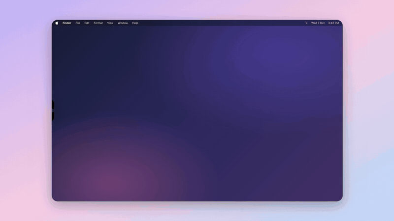

<div align="center">

# Edith

**A personal AI agent that remembers you, talks to you, and does the work on your Mac, your inbox, and your calendar.**



*One sentence: Eddy opens the browser, researches, and writes sourced notes into TextEdit.* · [Watch the MP4](docs/media/eddy-demo.mp4)

</div>

---

Most assistants start every conversation from zero. Edith is built for one person over the long
haul: it keeps durable memory of facts and past conversations, runs jobs on a schedule, and acts
across your apps. Anything that sends, posts, or submits waits for your approval.

## Get started in 6 steps

> Needs macOS 26+, Python 3.11+, and Xcode (Swift 6.2) for the notch. The backend alone runs anywhere.

**1. Install the backend**

```bash
git clone https://github.com/techwarq/Edith.git && cd Edith
python3.11 -m venv .venv          # keep it at .venv in the repo root, the notch looks for it there
.venv/bin/pip install -e .
```

**2. Add your keys**

```bash
cp .env.example .env
```

Fill in these two in `.env`. Everything else is optional and switches on a feature.

```bash
OPENROUTER_API_KEY=...   # chat, memory, voice, web search — one key for all of it
EDITH_API_TOKEN=...      # any random string, e.g. python3 -c "import secrets; print(secrets.token_urlsafe(32))"
```

Eddy starts with an empty memory and learns about you as she works for you. Nothing in the repo is
tied to any particular person.

**3. Start the backend** (skip this if you only use the notch, it starts the backend for you)

```bash
.venv/bin/uvicorn edith.server:app --port 8787
```

Open <http://localhost:8787> and paste your `EDITH_API_TOKEN` to chat in the browser.

**Or run the backend in Docker** (bring your own infra — databases included):

```bash
docker compose up -d                        # Eddy + Qdrant (vector DB), data in Docker volumes
docker compose --profile scheduler up -d    # ...plus a local Temporal for reminders and recurring jobs
                                            #    (then set TEMPORAL_ADDRESS=temporal:7233 in .env)
```

Already have a Qdrant or Temporal? Set `QDRANT_URL` / `TEMPORAL_ADDRESS` in `.env` and Eddy connects
to yours instead. Without Docker, memory still works: Eddy keeps an embedded Qdrant under `~/.edith/`.

**4. Point the notch at your backend**

Create `~/.edith/desktop_config.json` if your backend isn't at the default `http://127.0.0.1:8787`.

```json
{ "serverUrl": "http://127.0.0.1:8787", "token": "<your EDITH_API_TOKEN>" }
```

**5. Build and open the notch**

```bash
cd edith-widget && ./build-app.sh && open EdithWidget.app
```

A black notch appears on the left edge of your screen. Grant the permissions it lists
(Accessibility, Screen Recording, Microphone, Speech Recognition). If the backend isn't running, the
notch starts it and writes its logs to `~/.edith/server.log`.

**6. Talk to Eddy**

| Do this | To |
|---|---|
| Hold <kbd>⌃</kbd>, speak, let go | Ask by voice |
| <kbd>⌃</kbd><kbd>⌘</kbd> | Type instead |
| <kbd>Esc</kbd> | Stop whatever she's doing |

Try: *"Research how rocket engines work and write me a summary in TextEdit"*, *"What do you
remember about me?"*, or *"Remember that I prefer short answers"*.

Things that leave your machine (emails, WhatsApp messages, applications, posts) wait for you to
reply `/approve <id>`.

<details>
<summary><b>Optional setup</b></summary>

- **Browser control:** Eddy reads and fills web pages in Brave. Turn on Brave → View → Developer →
  Allow JavaScript from Apple Events.
- **Google:** type `/google login` in chat (needs `~/.edith/google_client_secret.json`).
- **WhatsApp:** type `/whatsapp login` and scan the QR code.
- **Scheduled jobs:** `docker compose --profile scheduler up -d` (or set `TEMPORAL_*` for Temporal Cloud),
  then run `.venv/bin/python -m edith.temporal.worker` if you're not using Docker.
- **Better web search:** set `GEMINI_API_KEY` for Google Search grounding.
- **Plugins:** `EDITH_PLUGINS=career` adds a job-application pipeline, startup finder + cold email,
  founder outreach and a LinkedIn/X content planner. It writes from your own profile file
  (`edith/plugins/career/career_profile.example.json` → `~/.edith/career_profile.json`).
- **Android:** set your backend URL in `edith-android/capacitor.config.json` before building.
- **Terminal only:** `.venv/bin/python main.py` chats in the terminal, no server or notch needed.
</details>

## What it does

| | |
|---|---|
| 🧠 **Remembers** | A self-organizing memory: after each exchange she files what matters into areas of your life, links related memories, and updates old ones when things change. Plus full keyword-searchable history. |
| 🎙️ **Talks** | Hold <kbd>⌃</kbd> to talk to **Eddy**, a notch on the edge of your screen. She speaks back. |
| 🖥️ **Uses your Mac** | Drives apps through the Accessibility tree and browser pages through the DOM. Asks before sends and submits, and stops when you take over. |
| 📬 **Works your accounts** | Gmail, Drive, Calendar, Docs, Sheets, WhatsApp, GitHub, Vercel, and any MCP server you add. |
| ⏰ **Runs on its own** | Reminders, recurring jobs and nightly reflection on Temporal — plus, with the career plugin, a job-application pipeline and a LinkedIn content engine. Each one is opt-in. |
| 🔎 **Researches** | `deep_research` breaks a question into sub-questions, searches each one, and writes a sourced answer. |
| 📊 **Watches itself** | Every LLM and tool call is traced with cost and latency. An eval harness scores its answers (its first run caught a real hallucination bug). |

## Clients

| Client | Stack | |
|---|---|---|
| **Eddy notch** (`edith-widget/`) | Swift, macOS | Voice notch on the left screen edge. Starts the local server so macOS permissions cover it. |
| **Web app** (`edith/web/`) | Vanilla JS PWA | Chat, Goals, Todos, Insights, MCP tabs (+ Jobs and Content with the career plugin). Served by the API. |
| **Android** (`edith-android/`) | Capacitor | Mobile chat and push notifications. |
| **Desktop widget** (`edith-desktop/`) | Electron | Always-on-top voice widget. |
| **Dashboard** (`edith-dashboard/`) | Next.js | Traces, spend, evals, goals. |

## How it works

```
             ┌──────────── clients ─────────────┐
             │ Eddy notch · Web · Android · CLI │
             └────────────────┬─────────────────┘
                              │ SSE
                    ┌─────────▼──────────┐
                    │  FastAPI server    │
                    │  agent tool loop   │──── Temporal (scheduled jobs)
                    └─────────┬──────────┘
          ┌───────────────────┼────────────────────┐
     ┌────▼─────┐       ┌─────▼──────┐       ┌─────▼──────┐
     │  Memory  │       │   Tools    │       │  Approval  │
     │ SQLite + │       │ Mac, Google│       │   queue    │
     │ FTS5 +   │       │ WhatsApp,  │       │ (sends and │
     │ Qdrant   │       │ web, MCP…  │       │  submits)  │
     └──────────┘       └────────────┘       └────────────┘
```

- **Agent loop**: OpenRouter tool calling (default `qwen/qwen3.7-flash`, change it with
  `EDITH_MODEL`), with retry/backoff, an iteration cap, and context trimming for long tool chains.
- **Memory** (`edith/memory/`):
  - Working memory: the last 40 turns of the conversation.
  - The brain ([A-MEM](https://arxiv.org/abs/2502.12110)): each exchange becomes a note with keywords,
    tags, a one-line context and a region of your life that Eddy picks herself. New notes link to
    related ones and rewrite them when something changes. Core notes (who you are, how you like
    things done) are always in her prompt; the rest are recalled by meaning.
  - Exact recall: SQLite FTS5 over all history.
  - Storage: SQLite for everything structured, Qdrant for vectors (OpenRouter embeddings).
- **Mac control**: a decider model picks each step from a text table of on-screen elements. A
  vision model is used only as a one-step fallback. Sends and submits need confirmation, stop
  stays in effect until you resume, and runs have time and step limits.
- **Autonomy, gated**: every scheduled job is opt-in and safe to re-run. Anything that leaves your
  machine (email, WhatsApp, applications, posts) waits in an approval queue.

<details>
<summary><b>Repository layout</b></summary>

```
edith/
├── server.py, cli.py, agent.py, bootstrap.py, prompts.py
├── llm/               OpenRouter tool-calling loop
├── memory/            storage/ (sqlite, qdrant), brain/ (A-MEM), conversation, records/
├── tools/             LLM tools by domain: growth/, ops/, productivity/, search/, system/
├── integrations/      voice, WhatsApp, browser, push, google/
├── computer_use/      Accessibility + DOM perception, step-by-step Mac operator
├── plugins/career/    opt-in: job pipeline, startup finder, outreach, LinkedIn planner
├── temporal/          Scheduled and recurring workflows
├── observability/     Tracing, spend, evals
└── goals/, todos/, mcp/, monitor/, web/

edith-widget/     Eddy notch (Swift)
edith-desktop/    Electron widget
edith-android/    Capacitor app
edith-dashboard/  Next.js dashboard
tests/            pytest suite
```
</details>

## Tests and deploy

```bash
pytest
```

Self-host with `docker compose`, or deploy the included `Dockerfile` anywhere (Railway, Fly, a VPS).

## License

[MIT](LICENSE)
