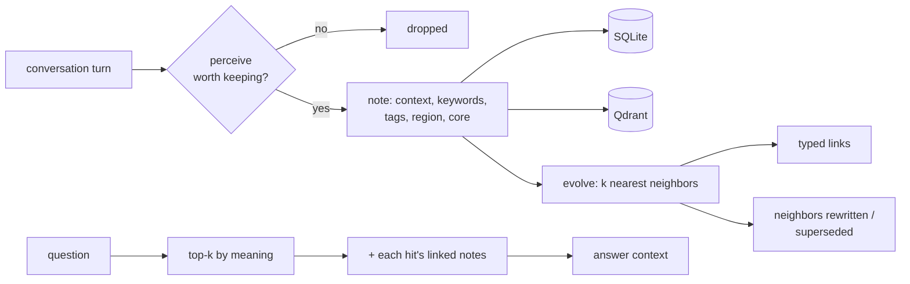

# Eddy's brain

Long-term memory as a network of notes that organizes itself. It's an implementation of
[A-MEM](https://arxiv.org/abs/2502.12110), tuned to run on very cheap models:
`qwen3.7-flash` (~$0.03 per million input tokens) for every memory decision and
`pplx-embed-v1-0.6b` ($0.004 per million) for vectors.

Retrieval is the easy part. The brain's job is three decisions most memory layers leave to the
caller:

1. **Whether to remember at all.** Small talk, acknowledgements and one-off lookups are dropped
   before anything is stored (about 20% of LOCOMO's turns).
2. **Where it belongs.** Each note gets a *region* of the user's life ("career", "health", ...).
   No regions are predefined; they appear as the user talks about things. Lasting facts about who
   the user is are marked *core* and are always in the agent's prompt.
3. **What it changes.** A new note is compared with its nearest neighbors. Related notes are
   linked with a typed relation ("updates", "contradicts", "part of"...), and neighbors whose
   meaning changed are rewritten. When a fact stops being true ("left Acme" vs "works at Acme"),
   the old note is rewritten as past and loses its core status instead of being deleted.

## How a memory is written and read

`recall()` returns the top-k notes by meaning plus up to three linked notes per hit. The agent
gets connected context (the job *and* the fact that it was later left) instead of isolated
snippets. That's where most of the open-domain reasoning gain comes from.

## Code

| File | Role |
|---|---|
| `__init__.py` | `Brain`: the only interface the rest of Eddy uses: `remember`, `remember_later`, `recall`, `core`, `forget` |
| `cortex.py` | The two LLM steps (`perceive`, `evolve`) as pure functions, with no storage |
| `notes.py` | SQLite tables: `memory_notes`, `memory_links`, `memory_refs` (links to goals, todos, ...) |

Writes run on a single background thread, so a turn never waits on memory, and note *n* is
always filed before note *n+1* evolves against it. The model's output is never trusted blindly:
link and update targets are restricted to the neighbor ids it was actually shown, malformed
JSON gets one retry, and a failed evolution keeps the note and only loses its links.

## Benchmark

On [LOCOMO](https://snap-research.github.io/locomo/), using
[mem0's own harness](https://github.com/mem0ai/memory-benchmarks) (same answer and judge prompts):

| | Eddy | mem0 platform |
|---|---|---|
| Overall | **90.4%** | 92.3% |
| Open-domain reasoning | **86.3%** | 76.5% |
| Temporal | 88.5% | 96.0% |
| Models | qwen3.7-flash, gpt-4o-mini judge | gpt-5 answerer and judge |
| Run cost | $0.84 | — |

Scope: all 10 conversations, ingested about halfway to keep the run under $1, scored on the 820
of 1,540 questions whose evidence was ingested, against mem0's published per-question results
for exactly those 820. Full breakdown in the [main README](../../../README.md#memory-benchmark-near-top-recall-on-cheap-models).

Since that run, `perceive` resolves relative dates ("last week") to absolute ones when a note is
filed. That targets the temporal gap above and hasn't been re-benchmarked yet.

## Tests

`tests/memory/test_brain.py` covers perceive/evolve parsing, superseding, linked recall and the
background writer, all with a fake LLM.
